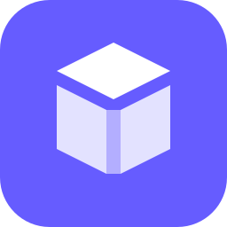

<div align="center">
  

  <h1>Open Inventory</h1>

  <p><strong>Self-hosted inventory and stock management for teams, spaces, and physical things.</strong></p>

  <p>
    <a href="https://github.com/Utzel-Butzel/inventory/actions/workflows/deployment-check.yml"></a>
    <a href="./LICENSE"></a>
    <a href="https://github.com/Utzel-Butzel/inventory/pkgs/container/inventory"></a>
  </p>

  <p>
    <a href="https://openinventory.polyxo.de">Website</a> ·
    <a href="https://demo.openinventory.polyxo.de/login?demo=1">Live demo</a> ·
    <a href="https://docs.openinventory.polyxo.de">Documentation</a> ·
    <a href="#quick-start">Quick start</a>
  </p>
</div>

Open Inventory helps teams, makerspaces, and businesses keep track of equipment,
supplies, and other physical assets. Catalog what you own, find where it is,
and manage stock, reservations, and shared equipment on your own infrastructure.

Explore the [live demo](https://demo.openinventory.polyxo.de/login?demo=1) or visit
[the website](https://openinventory.polyxo.de) for screenshots, use cases, and
app downloads.

## Features

| | |
| --- | --- |
| **Flexible inventory** | Custom types and fields, relationships, tags, photos, attachments, and variants |
| **Stock management** | Quantities and serial numbers, location balances, inventory counts, reservations, bills of materials, and purchase orders |
| **Mobile capture** | QR and barcode scanning, printable labels, photo batches, and native iOS and Android apps |
| **Maps and rooms** | Geographic locations, indoor 3D placement, and LiDAR room scans through the iOS app |
| **Team access** | Multiple organizations, configurable roles and permissions, and notifications |
| **Integrations** | CSV/Excel/PDF exchange, a REST API, webhooks, and an opt-in MCP endpoint |
| **Optional AI** | Item recognition, photo counting, image generation, and translations |

See the [feature overview](https://openinventory.polyxo.de/features) for more.

## Quick start

You need Git, Docker with Compose v2, OpenSSL, and `curl`.

```bash
git clone https://github.com/Utzel-Butzel/inventory.git
cd inventory
./scripts/install.sh
```

The installer generates secrets, starts the app and PostgreSQL, applies database
migrations, and prints the sign-in details. By default, the app runs at
[http://localhost:3000](http://localhost:3000).

> [!IMPORTANT]
> After the first sign-in, change the generated password under **Settings →
> Users**. Then remove `BOOTSTRAP_ADMIN_PASSWORD` and
> `BOOTSTRAP_ADMIN_PASSWORD_ONCE` from `.env` and restart the stack.

For production setup and deployment options, follow the
[installation guide](https://docs.openinventory.polyxo.de/installation) or the
[website's deployment guide](https://openinventory.polyxo.de/docs), including
Docker Compose, Dokploy, and Coolify.

## Documentation

The full documentation lives at
**[docs.openinventory.polyxo.de](https://docs.openinventory.polyxo.de)**.

- [Configuration and branding](https://docs.openinventory.polyxo.de/configuration)
  · [Environment variables](https://docs.openinventory.polyxo.de/environment-variables)
- [Authentication providers](https://docs.openinventory.polyxo.de/authentication)
- [Operations and backups](https://docs.openinventory.polyxo.de/operations)
- [Labels and printing](https://docs.openinventory.polyxo.de/printing)
- [REST API](https://docs.openinventory.polyxo.de/api)
  · [API reference](https://docs.openinventory.polyxo.de/api-reference)
  · [MCP integration](https://docs.openinventory.polyxo.de/mcp)

## Development and contributing

The web app uses Next.js, React, TypeScript, PostgreSQL, and Drizzle ORM. This
repository also contains the native iOS and Android apps and deployment templates.

- [Local development, commands, and project structure](docs/development.md)
- [iOS setup and TestFlight deployment](ios/Inventory/README.md)
- [Android setup and feature parity](android/README.md)
- [Website and documentation source](https://github.com/Utzel-Butzel/open-inventory-website)

Contributions and bug reports are welcome. For larger changes, open an
[issue](https://github.com/Utzel-Butzel/inventory/issues) first to discuss the scope.
Before opening a pull request, run `npm run lint`, `npm run typecheck`, and the
relevant test suites, and include a short description of how you verified the change.

## License

[MIT](LICENSE).
